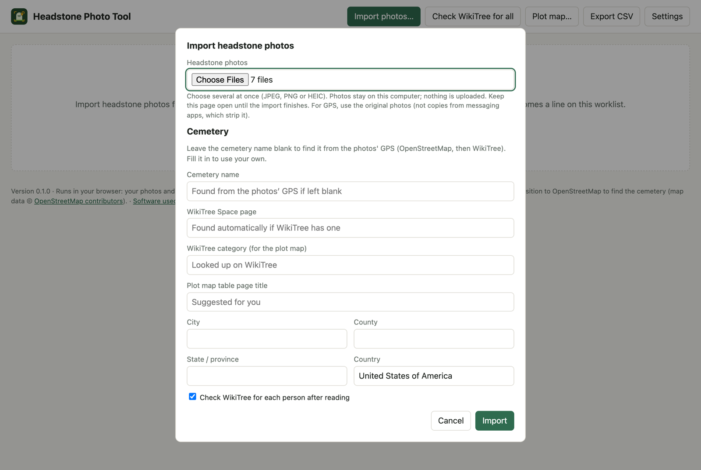
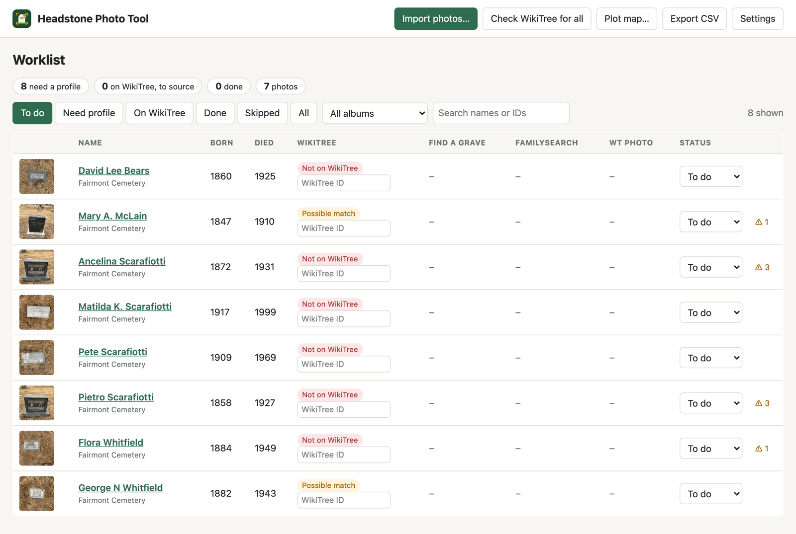
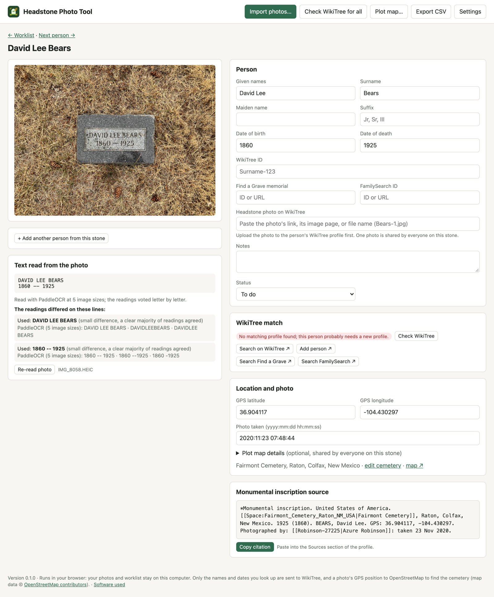
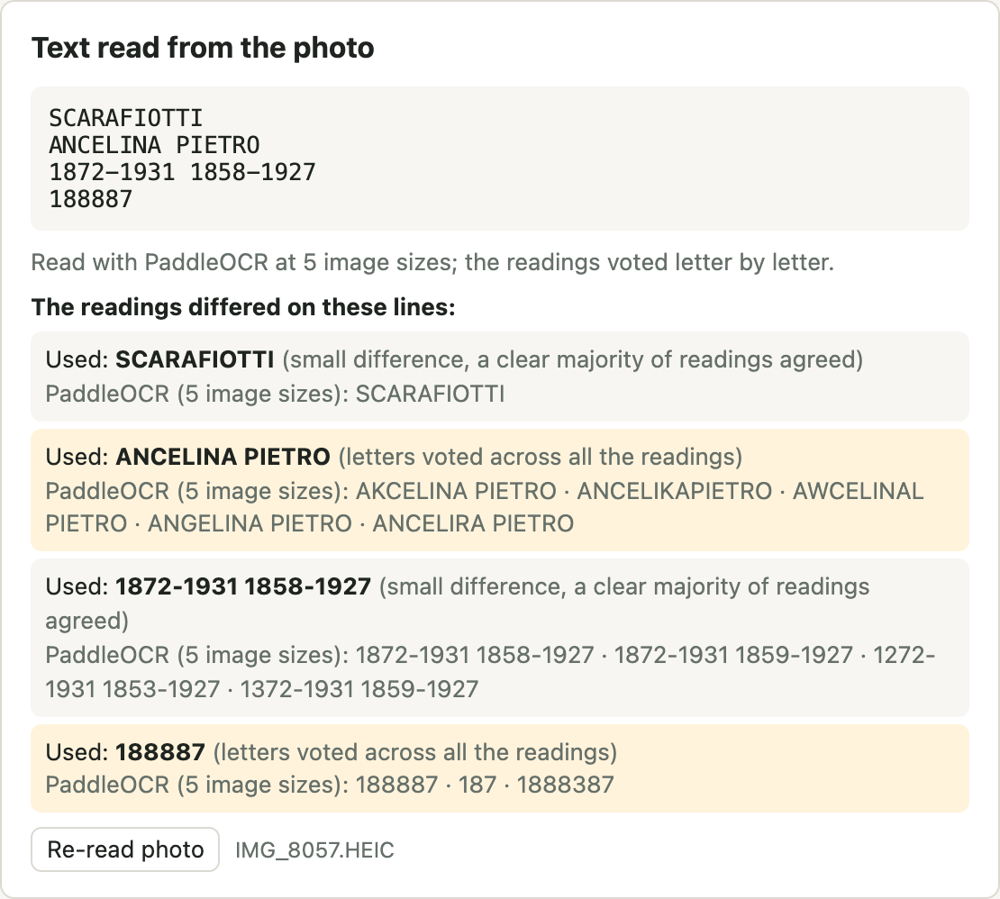
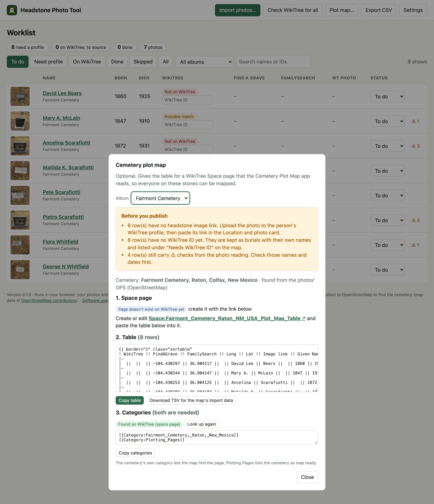

# Headstone Photo Tool

Reads headstone photos (names, dates, GPS) and builds a worklist for creating WikiTree profiles: checks WikiTree for
each person, builds the Monumental inscription source citation, and prepares an optional Cemetery Plot Map table.

Two versions share the same code for everything except reading the photos and storing the data:

| | Mac version (`./start.sh`) | Browser version (`headstone-tool/`) |
| --- | --- | --- |
| Runs | a small local server on your Mac | in the web page; upload it to a static host such as the WikiTree Apps server |
| Photos come from | a Photos album or a folder | files you choose (JPEG, PNG, HEIC) |
| Reads text with | Apple Vision, plus PaddleOCR if installed | PaddleOCR (in WebAssembly) |
| Your data | `data/` folder | this browser's storage (download a backup from Settings) |

## Screenshots

These are from the browser version, using seven real photos from Fairmont Cemetery in Raton, New Mexico.

**Import.** Choose photos and leave the cemetery blank: it is found from the photos' GPS.

**The worklist.** Every person found, with a WikiTree match where there is one. ⚠ marks names or dates to check against the photo.

**A person.** The photo, the fields to correct, WikiTree matches, GPS, and the Monumental inscription source ready to copy.

**How a stone was read.** Each photo is read several times and the readings vote letter by letter. Lines they disagreed on are shown, so you know what to check.

**Cemetery plot map.** The table and categories for the Cemetery Plot Map app, with checks before you publish.

## Install and run (Mac version)

    git clone <this repository>
    cd headstone-photo-tool
    ./start.sh          # http://localhost:8777  (PORT=9000 ./start.sh to change)

Needs Node 18+ and the Xcode command line tools (`xcode-select --install`) to build the OCR helper once.

**Optional but recommended: `npm install`** (about 330 MB, mostly the ONNX runtime) adds PaddleOCR as a second text reader.
Without it the tool works with Apple Vision alone.

## Workflow

1. **Import photos…** Pick a Photos album (the first time, allow Automation access to Photos) or a folder.
   The cemetery applies to the whole album. Leave its name blank and the tool finds it from the photos' GPS: the cemetery's name
   and outline from OpenStreetMap (Overpass, with Nominatim as a fallback when Overpass is busy), then the town, county and state,
   then the WikiTree Space page if WikiTree has one at the usual address (`Name_Town_ST_USA`). Or type it in yourself. **Find
   cemetery from photo GPS** in the cemetery dialog re-runs it. Only the position goes to OpenStreetMap; map data © OpenStreetMap
   contributors (ODbL).
2. Each photo is read for text and its EXIF GPS and date taken. Apple Vision reads it once and, if installed, PaddleOCR reads it
   at three image sizes (its mistakes change with size). The readings are combined by voting letter by letter, so a letter
   that one reading got wrong is outvoted. Lines the readings disagree on are shown under "Text read from the photo" on the
   person page, and the people on that stone are marked ⚠. Stones with two people side by side and a family-name heading are
   split into two people, paired left to right (check the pairing). Each person found becomes a worklist line.
   If "Check WikiTree" is ticked, each person is searched on WikiTree. A strong match (name plus dates agree,
   no close runner-up) fills in the WikiTree ID automatically; weaker ones are shown as candidates to confirm.
3. **Click a name** to open that person's page: the photo, the text read, and fields for given names, surname,
   maiden name, birth and death dates, WikiTree ID, Find a Grave and FamilySearch. OCR is never perfect on
   weathered stone, so check names and dates against the photo. Everything saves as you type.
4. Create the profile on WikiTree (the page has Add person / search links), then paste the new ID in the
   WikiTree ID field. Set Status to Done once the profile is sourced.
5. **Copy citation** gives the Monumental inscription source, for example:

       *Monumental inscription. United States of America. [[Space:Fairmont_Cemetery_Raton_NM_USA|Fairmont Cemetery]], Raton, Colfax, New Mexico. 1919 (1905). TAYLOR, Bartonus A. GPS: 36.904000, -104.430471. Photographed by: [[Robinson-27225|Azure Robinson]]: taken 21 Nov 2020.

   Photographer name and WikiTree ID are in **Settings**. Without them the citation still carries the date the photo was taken
   ("Photographed: taken 21 Nov 2020."); with them it reads "Photographed by: [[Robinson-27225|Azure Robinson]]: taken 21 Nov 2020."

**Export CSV** writes the whole worklist. Data lives in `data/worklist.json`; photos are never modified.

## Optional: cemetery plot map

For the WikiTree Cemetery Plot Map app (`cemetery-map`). **Plot map…** in the top bar builds the table that app reads from a
WikiTree Space page, using the same columns and cell wrappers it writes itself:

    {| border="1" class="sortable"
    ! WikiTree !! FindAGrave !! FamilySearch !! Long !! Lat !! Image link !! Given Names !! Surname !! Maiden !! Birth !! Death !! Notes
    |-
    | [[Taylor-133877]] || {{FindAGrave|12345678}} || {{FamilySearch|ABCD-123}} || -104.430471 || 36.904000 || [https://www.wikitree.com/photo.php/5/5f/Bears-1.jpg Headstone] ||  ||  ||  ||  ||  || 
    |}

1. Create the Space page (the dialog suggests a title such as `Fairmont Cemetery Raton NM USA Plot Map Table` and links to it)
   and paste the table.
2. Put the page in **both** categories the dialog shows: the cemetery's own WikiTree category and `Category:Plotting_Pages`.
   The first lets the map find the page, the second lists the cemetery as "map ready". The cemetery category is looked up
   from the WikiTree API (`getCategories`): first on the cemetery's Space page (enter it in the cemetery fields), otherwise
   on profiles from the album that are already on WikiTree. It is saved on the album; "Look up again" or the button in the
   cemetery dialog refreshes it, and you can type one yourself. If nothing is found the dialog says the category is a guess.
   The dialog also asks WikiTree whether the table page exists yet and which of the two categories it is missing.
3. Per stone (shared by everyone on it): **Headstone photo on WikiTree** is a main field on the person page. Paste a photo
   link, an image page, or just the file name (`Bears-1.jpg`); it is turned into the `photo.php` address the map uses. Section,
   Plot, Row, Monument and Reference are in the "Cemetery Map details" card (optional text boxes) and become columns only when some row has a value.
4. People with a WikiTree ID are written as `[[ID]]` (the map takes their names from WikiTree). People without one are kept as
   burials with their own names and dates and show under "Needs WikiTree ID" on the map. Skipped people are left out.
5. "Download TSV" gives the same rows for the map's **Import data**.

The dialog warns about rows with no GPS, no photo link or no WikiTree ID, and about names still marked ⚠.
The generated table was checked against the map app's own table reader.

## Browser version

`npm install` then `npm run build:web` builds `headstone-tool/` (about 42 MB: PaddleOCR's models, the WebAssembly runtime, OpenCV.js and the
page). Upload its contents to any static host; all paths are relative, so any folder works (for example
`apps/robinson27225/headstone-photo-tool/`). To try it first:

    npm run serve:web        # prints the test address, ?api=/wtapi plus proxies for the map lookups

WikiTree's API only answers pages on wikitree.com, so on localhost the lookups go through a small proxy that `serve:web`
provides (the `?api=/wtapi` part). On the apps server nothing extra is needed.

- **Reading.** Each photo is read by PaddleOCR at several image sizes (Settings: 3, 5 or 7 readings; 5 is the default, about 7
  seconds a photo) and the readings vote letter by letter. Without Apple Vision there is one fewer voter, so expect a little more
  hand correction than on the Mac. Keep the page open and in front while importing.
- **HEIC.** Safari opens HEIC itself; Chrome and Firefox get a conversion step (a 1.3 MB library, loaded only when needed).
  GPS and date are read from the original file either way. Photos copied through messaging apps usually have the GPS removed.
- **First use** downloads about 16 MB of models, which the browser then keeps.
- **Storage.** The worklist and downsized copies of the photos (2400 px) are kept in the browser (IndexedDB) and never uploaded.
  Clearing site data erases them, so use **Settings, Download backup**. There is no restore button yet.
- **Sourcer.** The person page embeds the person as JSON for the WikiTree Sourcer patch in `sourcer-support/`; its URL match
  pattern would need the apps-server address.
- **Not in the browser version:** Photos albums and folder import (choose files instead), re-reading from the original photo
  (it re-reads the stored 2400 px copy).

The shared code is in `lib/` (loads in Node and in the browser), the page in `public/`, the Mac-only parts in `server.js` and
`lib/importer.js`, the browser-only parts in `web-src/`.

## WikiTree matching notes

- Uses the public `searchPerson` API; no login needed. Private profiles cannot be matched.
- WikiTree only allows birth dates after 1940 to be searched by logged-in members, so those are left out of the
  query and matching falls back to name plus death date.
- Find a Grave and FamilySearch are entered by hand (paste an ID or a URL; the ID is extracted). Search links are provided.

## Creating the WikiTree profile with Sourcer

Support for this tool is proposed to WikiTree Sourcer as [pull request 535](https://github.com/RobPavey/wikitree-sourcer/pull/535).
It adds a site with the id `wtahdstn` (Sourcer's maintainer asked for a `wta` prefix for WikiTree apps) that reads a person page of
the browser version in an apps-server folder named `headstone-tool`, and narrows the `wikitree` site's patterns to
`www.wikitree.com` and `staging.wikitree.com` so the two do not overlap. Until it is in a Sourcer release,
`sourcer-support/headstone-site.patch` is the same change, made against Sourcer's `develop` branch. To try it without touching a
branch you are working on, give it its own working folder:

    cd ~/code/wikitree-sourcer
    git worktree add -b add-wtahdstn-site ../wikitree-sourcer-wtahdstn upstream/develop
    cd ../wikitree-sourcer-wtahdstn
    git apply /path/to/headstone-photo-tool/sourcer-support/headstone-site.patch

Then in Chrome open `chrome://extensions`, switch off any other WikiTree Sourcer, choose **Load unpacked** and select
`wikitree-sourcer-wtahdstn/extension` (there is no build step). Open a person page of the tool, reload it, and click Sourcer in
the toolbar; the first time, Sourcer asks for permission to use the site.

**To add a person:**

1. On the person's page in this tool, open Sourcer and choose **Build Citation**, then **Source**. (Inline and narrative also work.)
2. On WikiTree, click **Add person** (the button on the person page opens WikiTree's Special:EditFamily) and open Sourcer.
3. Choose **Set Fields from Citation Data**. Sourcer fills in the name, last name at birth (maiden name), birth and death dates, and
   puts the **Monumental inscription** source line in the Sources section.

What the citation becomes depends on the type chosen in step 1:

| Type | Result |
| --- | --- |
| Source (the normal choice) | `*Monumental inscription. United States of America. [[Space:…|Fairmont Cemetery]], Raton, Colfax, New Mexico. 1925 (1860). BEARS, David Lee. GPS: …` in Sources |
| Narrative | a burial sentence, "David died on 12 February 1925 and was buried at Fairmont Cemetery, Raton, Colfax, New Mexico, United States of America.", with the Monumental inscription as its reference |
| Inline | the Monumental inscription as a reference in the biography |

The death place is left blank on purpose: the cemetery is where the person is buried, not where they died.

Why this way: Sourcer's **Save Person Data** is offered only for profile pages, and a headstone is a record, so Sourcer's record flow
(Build Citation, then Set Fields from Citation Data) is the right fit. The person page embeds the person as JSON
(`<script id="headstone-person-data">`), which the Sourcer extract step reads.

What the change touches in Sourcer: the new `wtahdstn` site (its own folder and tests), the places Sourcer registers sites, and
one line in the `wikitree` site's patterns. It passes Sourcer's whole test suite. It was also checked by loading it in Chrome: the
extension registers, picks the tool's popup on a person page of the deployed copy, reads the person and offers Build Inline Citation,
Build Narrative with Citation and Build Source Citation, and Set Fields from Citation Data was tried by hand on a real WikiTree
Add person page. The Mac version (`localhost` with a port) is not supported: a Chrome match pattern cannot contain a port.

## Tests

    node test/parse.test.js
    node test/categories.test.js

## Known limits

- **Reading the stone is the weak spot.** On the seven Fairmont test stones both versions found every person and got nearly
  every name and date, with single-letter slips: "McClain" came out as "MCLAIN" (browser) or "MOCLAIN" (Apple Vision), "Angelina"
  as "Ancelina" (Mac version), and "George N" as "Georgen" at 5 readings in the browser (right at 7). Pietro's birth year
  (1858 or 1859) is hard to read even in the photo. More readings help (Settings, browser version), but weathered or
  low-contrast engraving, and stones photographed at an angle or in shadow, are harder. Treat every result as a draft to check
  against the photo; doubtful lines are marked ⚠. In-browser Tesseract was tried first and returned noise.
- **The Mac version is macOS only** (Apple Vision, Photos, `sips`); the browser version runs anywhere a current browser does. Photos never leave your computer; WikiTree lookups send only the names and
  dates being searched.
- Your photos, previews and worklist live in `data/`, which is not part of the repository.
- Date and name parsing covers common layouts (single names, couples side by side, family-name headings, "née"). Unusual
  layouts will need hand correction.

## Feedback

Please include, for a problem reading a stone, the photo (or what the stone says), what the tool read, and what it should have
read. The text read from each photo is shown on its person page.

## Logo and screenshots

`assets/` holds the logo (`logo.svg`, `icon.svg` and PNGs, drawn by `npm run assets`; the wordmark uses Source Sans 3 Bold, SIL Open
Font License, turned into outlines). `docs/screenshots/` is made by `npm run screenshots` from the real browser version: build it
(`npm run build:web`), start `node scripts/serve-web.js`, then `PHOTOS="path/to/photos" npm run screenshots`. Needs Chrome and an
internet connection, and takes a few minutes because the photos are really imported. For the WikiTree apps page, `assets/logo-1080.png`
is the 1080 px square logo and `assets/icon-96.png` the 96 px icon.

## License

MIT, see `LICENSE`.
